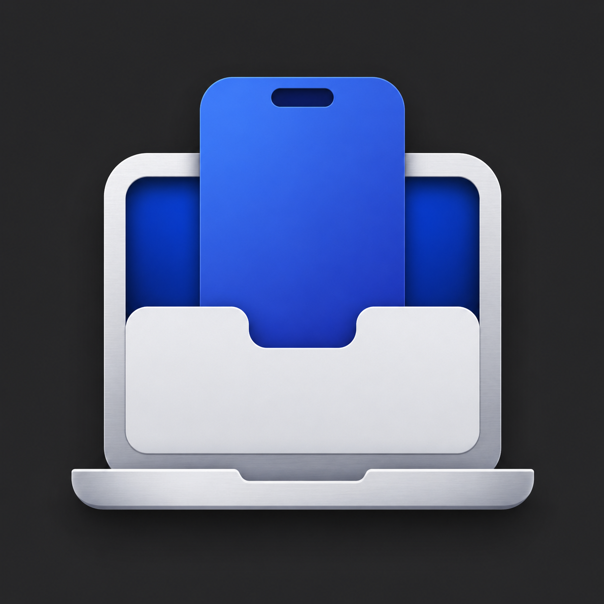
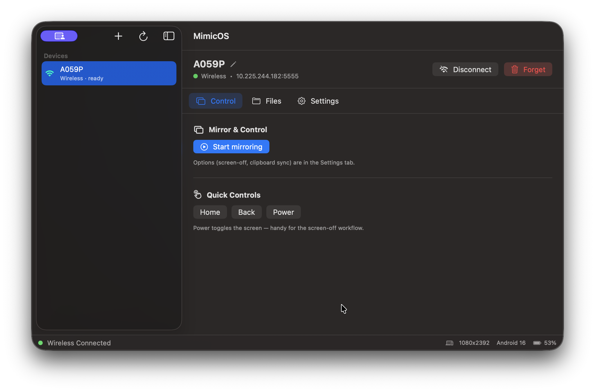
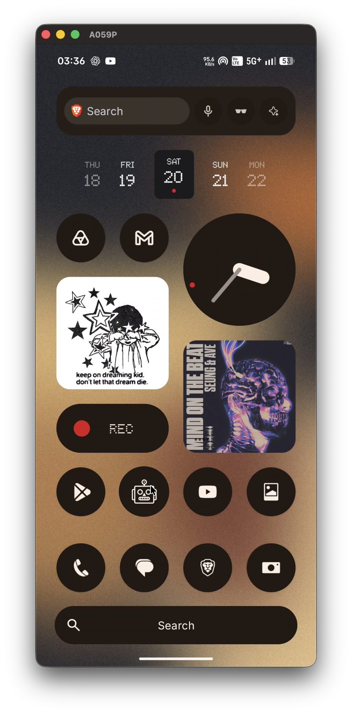
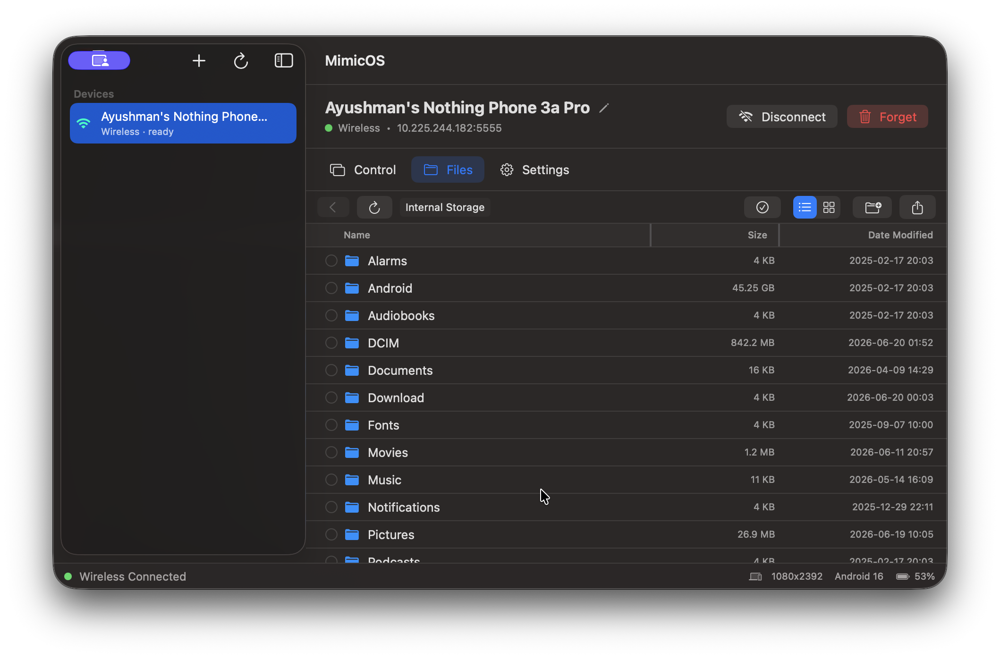
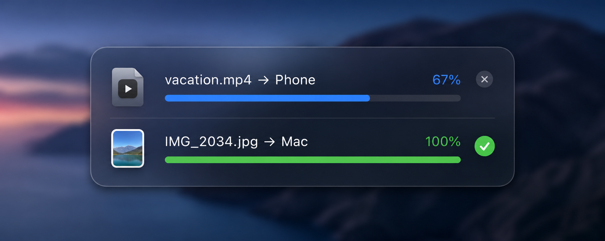
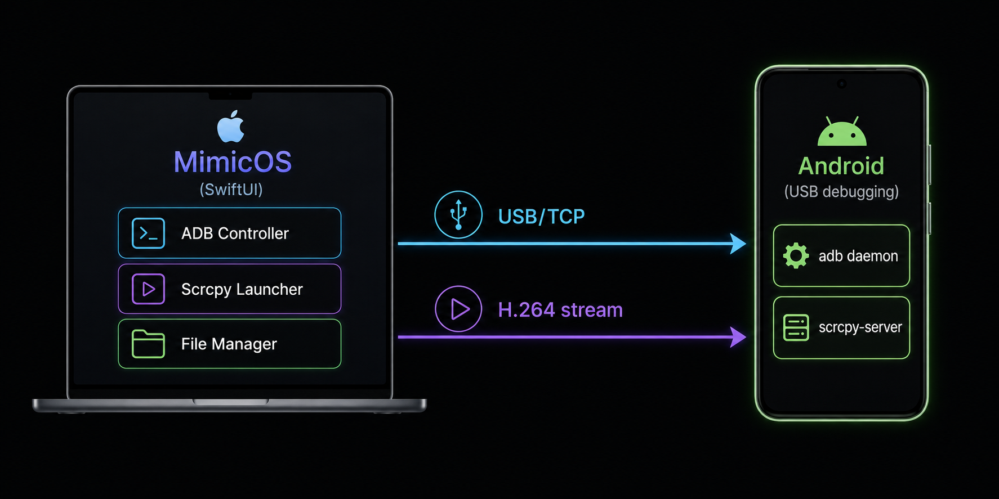
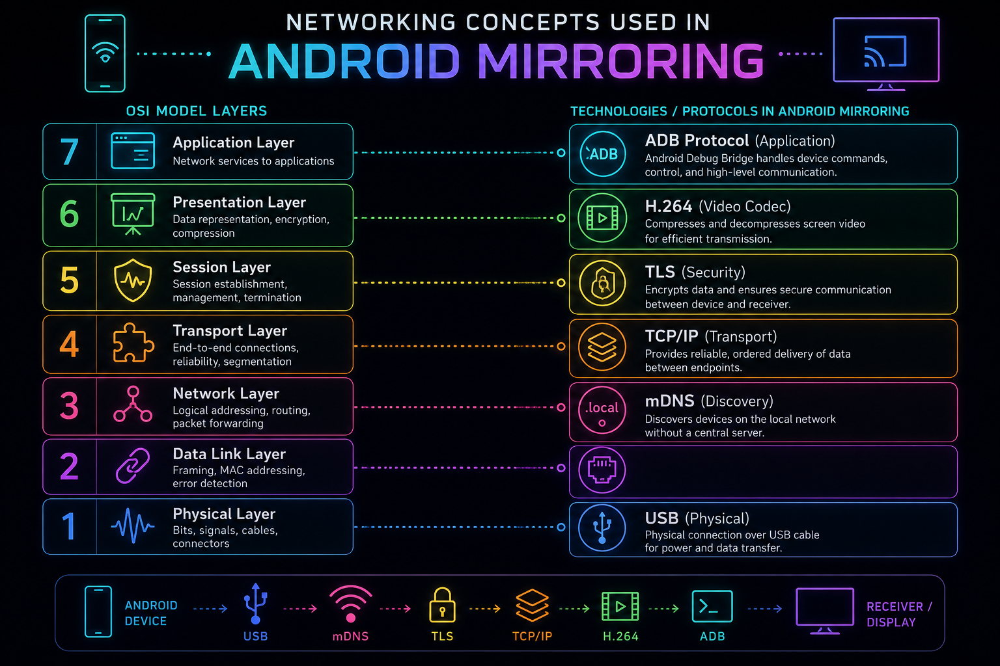
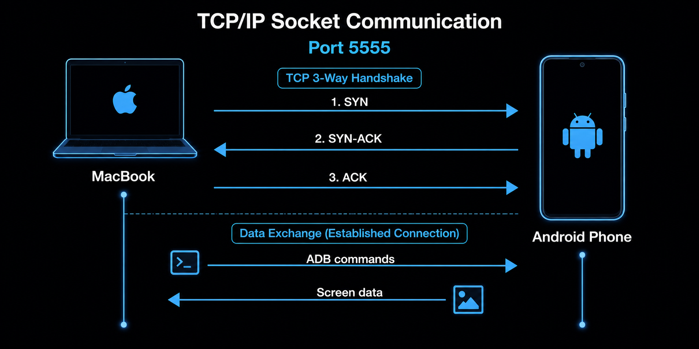
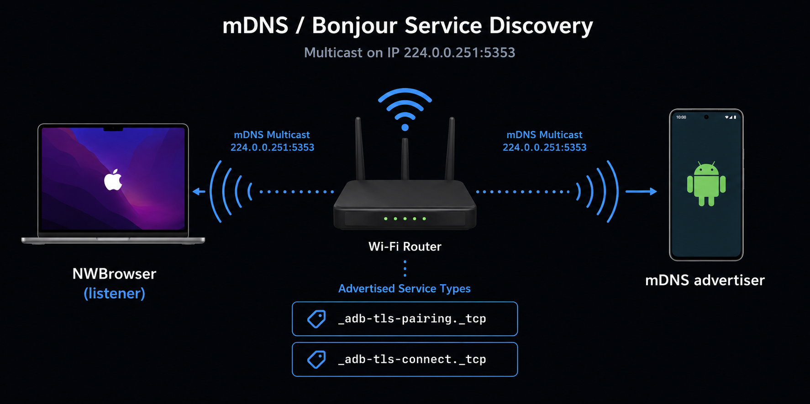
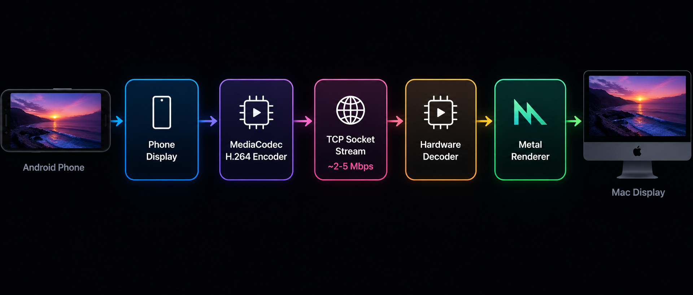

<div align="center">



# MimicOS

### Your Android, on your Mac. No apps. No root. No limits.

[](LICENSE)
[](https://www.apple.com/macos)
[](https://swift.org)
[](https://github.com/ayushmaninbox/mimic-os/pulls)



**MimicOS** is a free, open-source, native **SwiftUI** Mac app that lets you fully control your Android phone from your Mac — mirror the screen, transfer files, automate taps, sync clipboards, and more. **Zero apps installed on the phone.** Just enable USB debugging once and you're in.

[Features](#-features) · [Quick Start](#-quick-start) · [How It Works](#-how-it-works) · [Tech & Concepts](#-technology--networking-concepts) · [Download](#-download--install) · [Roadmap](#-roadmap) · [License](#-license)

</div>

---

## ✨ Features

### 🪞 Screen Mirroring & Full Control
Mirror your Android phone's entire display in a native window on your Mac. Use your Mac's mouse and keyboard to interact with any app — type messages, scroll feeds, play games. The mirror runs at **low latency** with hardware-accelerated H.264 decoding.

<p align="center">
  
</p>

### 🌙 Screen-Off Control (Sleeping Phone Mode)
The **killer feature**. Your phone's physical screen stays completely black (saving battery and preventing burn-in) while you fully control it from your Mac. To anyone looking at your desk, your phone appears asleep — but you're scrolling Twitter on your Mac.

### 🔊 Audio Routing
Route your phone's audio output to your Mac's speakers, keep it on the phone, or play on **both simultaneously**. Perfect for watching videos or taking calls through your Mac.

| Route | Behavior |
|-------|----------|
| **This Mac** | Audio forwards to Mac; phone goes silent |
| **Phone** | Audio stays on phone (speaker/Bluetooth/wired) |
| **Both** | Plays on Mac AND phone simultaneously |

### 📂 Full File Manager (Finder-Style)
A complete, two-way file browser built into the app. Browse your phone's storage like a native Finder window.

- **Browse** — Navigate the full Android filesystem with breadcrumb navigation
- **Upload** — Drag files from Finder onto the app, or use the file picker. MediaStore auto-scans so files appear instantly in Gallery/Files
- **Download** — Copy files from phone to Mac with a save dialog
- **Delete** — Remove files/folders on the phone
- **Create folders** — Make new directories right from the app
- **List & Grid views** — Switch between detailed list and visual grid (with image/video thumbnails)
- **Sortable columns** — Sort by name, size, or date with resizable column headers
- **Multi-select** — Click, ⌘-click, ⇧-click for range selection. Bulk download or delete
- **Drag & Drop** — Drag files OUT of the app to Finder, or INTO the app from Finder
- **Quick Look preview** — Press Space to preview any file (images, videos, documents) using macOS Quick Look
- **Copy/Paste** — ⌘C copies phone files to Mac clipboard, ⌘V pastes Mac files to phone
- **APK installer** — Drop an `.apk` file and it gets installed on the phone automatically
- **Search** — Live filter files in the current folder, or perform a deep recursive search across subfolders or the entire phone using the integrated scope bar (just like macOS Finder)

<p align="center">
  
</p>

### 📋 Clipboard Sync
Copy text on your phone, paste it on your Mac — and vice versa. Works automatically during mirroring via scrcpy's native clipboard bridge. Background sync continues even when not actively mirroring (via a headless session).

### 📸 Screenshot Mirroring
Take a screenshot on your phone and it **automatically appears on your Mac's clipboard**. MimicOS watches the phone's Screenshots folder and pulls new captures instantly — paste them straight into Slack, Notes, or any app.

### 🤖 Quick Controls & Automation
Hardware button shortcuts without touching your phone:

| Button | Action |
|--------|--------|
| **Home** | Android home screen (keycode 3) |
| **Back** | Navigate back (keycode 4) |
| **Power** | Toggle screen on/off (keycode 26) |

Plus programmable automation via ADB:
- **Tap** at coordinates — `ADB.tap(serial, x, y)`
- **Swipe** gestures — `ADB.swipe(serial, x1, y1, x2, y2, duration)`
- **Type text** — inject text into any focused field
- **Launch apps** — open any app by package name
- **Key events** — send any Android keycode

### 📶 USB & Wireless Connections

MimicOS supports **two** ways to connect:

| Method | How | Best For |
|--------|-----|----------|
| **USB** | Plug in. Done. | Most reliable, screen-off works perfectly |
| **Hotspot** | USB once → auto-switches to wireless over phone's hotspot | No Wi-Fi available, mobile data only |

#### 🔥 Hotspot Mode (No Wi-Fi Needed)
When you're on mobile data with no Wi-Fi, MimicOS's **hotspot flow** gets you wireless:
1. Phone shares its hotspot → Mac joins it
2. Plug in USB → app detects the phone's IP via `ip addr`
3. Switches the phone to TCP/IP mode (`adb tcpip 5555`)
4. Connects wirelessly → **unplug the cable**

The phone falls back to USB mode on reboot, but while the session lasts, it's fully wireless over the hotspot.

### 🏷 Device Management
- **Rename devices** — Give friendly names ("My Nothing Phone") stored locally on Mac
- **Remember devices** — USB devices are persisted; reconnect offline devices with one click
- **De-duplicate** — Same phone on USB + wireless? MimicOS merges them into one entry using hardware fingerprinting (`ro.serialno`)
- **Disconnect / Forget** — Drop the connection or fully remove a device
- **Live status** — Battery level, Android version, screen resolution displayed in the status bar

### 📊 Transfer Progress & Cancellation
File transfers show **real-time progress bars** with byte-level accuracy. The app polls the growing destination file size to compute a live percentage. Transfers are **cancellable** — killing the process mid-transfer also cleans up partial files on the phone.

<p align="center">
  
</p>

---

## 🚀 Quick Start

### Prerequisites
- **macOS 14 (Sonoma)** or newer
- An Android phone with **USB debugging** enabled
- [Homebrew](https://brew.sh) (for dev builds — release `.dmg` needs nothing)

### One-Time Phone Setup
1. **Settings → About phone →** tap **Build number** 7 times (enables Developer options)
2. **Settings → System → Developer options →** enable **USB debugging**
3. Plug the phone into the Mac → tap **Allow** on the "Allow USB debugging?" prompt

### Build & Run

```bash
# 1. Clone the repo
git clone https://github.com/ayushmaninbox/mimic-os.git
cd mimic-os

# 2. Install the engine (adb + scrcpy via Homebrew)
./Scripts/setup.sh

# 3. Build & launch the app
swift run
```

### Or Download the `.dmg`

Head to [**Releases**](https://github.com/ayushmaninbox/mimic-os/releases) and grab the latest `MimicOS-vX.X.dmg`. Drag to Applications. Done.

> **First launch on an unsigned build:** right-click the app → **Open** → click Open again to bypass Gatekeeper.

---

## 🏗 How It Works

<p align="center">
  
</p>

```
MimicOS (SwiftUI)
   ├── ADB.swift ─────────→  adb binary  ──→  Android phone
   │    └── devices, files, input, info,       (USB debugging on)
   │        clipboard, wireless, automation
   │
   └── Scrcpy.swift ──────→  scrcpy binary ──→  scrcpy-server
        └── screen mirror + control              (pushed to phone,
            (incl. screen-off, audio,             runs temporarily)
             clipboard sync, UHID keyboard)
```

MimicOS is a **controller and UI layer** — it doesn't reimplement screen mirroring. It orchestrates two battle-tested open-source tools:

- [**adb**](https://developer.android.com/tools/adb) (Android Debug Bridge) — Device discovery, file transfer, input injection, system info
- [**scrcpy**](https://github.com/Genymobile/scrcpy) — Screen mirroring, control input, clipboard sync, audio forwarding

### Source Files

| File | Role |
|------|------|
| `MimicOSApp.swift` | App entry point, SwiftUI lifecycle |
| `ContentView.swift` | Main window layout — NavigationSplitView with sidebar + detail |
| `ControlPanelView.swift` | The detail pane — tabs for Control, Files, Settings |
| `AddDeviceSheet.swift` | The `+` button flow: USB guide, Hotspot guide |
| `AppModel.swift` | Central observable state — bridges engine ↔ UI |
| `ADB.swift` | All app-free Android control: devices, files, input, info, wireless, clipboard |
| `Scrcpy.swift` | Launches/stops mirror sessions, options management |
| `Shell.swift` | Async `Process` wrapper with cancellation support |
| `ToolLocator.swift` | Finds `adb`/`scrcpy` (bundled → Homebrew → PATH) |
| `BonjourBrowser.swift` | mDNS discovery of wireless-debugging phones via `NWBrowser` |
| `Device.swift` | Device model + DeviceInfo (battery, version, resolution) |
| `DeviceStore.swift` | UserDefaults persistence for remembered devices + custom names |

---

## 🔬 Technology & Networking Concepts

MimicOS is built on several important computer networking and systems concepts. Here's what's under the hood:

<p align="center">
  
</p>

### 🔌 ADB Protocol (Android Debug Bridge)

ADB is a **client-server protocol** that runs over USB or TCP/IP:

```
┌─────────┐         ┌────────────┐         ┌──────────┐
│  Client  │ ──────→ │  ADB Server │ ──────→ │  Daemon  │
│ (MimicOS)│  TCP    │ (Mac:5037) │  USB/TCP │ (Phone)  │
└─────────┘         └────────────┘         └──────────┘
```

- **Client** — MimicOS sends commands (e.g. `adb push`, `adb shell input tap`)
- **Server** — A daemon on the Mac (port `5037`) multiplexes connections to devices
- **Daemon (adbd)** — Runs on the phone, executes commands, returns results

**Key concepts demonstrated:**
- **Client-server architecture** — Three-tier with local daemon as intermediary
- **Port multiplexing** — Single server manages multiple device connections
- **Transport switching** — Same protocol works over USB (direct) or TCP/IP (network)

### 🌐 TCP/IP & Socket Communication

When switching from USB to wireless (hotspot mode), MimicOS uses classic TCP/IP networking:

```bash
adb tcpip 5555          # Switch phone's adb daemon to listen on TCP port 5555
adb connect 192.168.43.1:5555  # Connect over the network
```

<p align="center">
  
</p>

**Concepts:**
- **TCP sockets** — Reliable, ordered byte-stream communication
- **Port numbers** — Port `5555` for adb, port `5037` for the local server
- **IP addressing** — The phone has a private IPv4 address (RFC 1918: `10.x`, `192.168.x`, `172.16-31.x`)
- **Connection-oriented protocol** — TCP guarantees delivery (vs UDP)
- **NAT traversal** — When on a hotspot, the phone acts as the gateway (`192.168.43.1`)

### 📡 mDNS / Bonjour (Zero-Configuration Networking)

MimicOS uses **mDNS (Multicast DNS)** for network-level device discovery — the same technology that lets your Mac find AirPlay devices and printers without configuration. The app's `BonjourBrowser` listens for ADB services advertised by phones on the LAN.

```
Phone broadcasts:
  _adb-tls-connect._tcp.local.    → "I'm available, connect to me"

Mac (MimicOS) listens via NWBrowser:
  → Discovers phone name, resolves IP:port
```

<p align="center">
  
</p>

**Concepts:**
- **Multicast DNS** — Queries sent to `224.0.0.251:5353` (multicast group), all devices on the LAN respond
- **Service Discovery (DNS-SD)** — Structured service types (`_tcp`, `_udp`) with metadata
- **Zero-conf networking** — No manual IP configuration needed; devices find each other automatically
- **Apple Network framework** — `NWBrowser` for native, efficient mDNS listening on macOS

### 🎥 H.264 Video Streaming

Screen mirroring uses the phone's **hardware video encoder** to stream the display:

```
Phone screen → MediaCodec (H.264 encoder) → scrcpy-server
                                                  │
                                           TCP socket stream
                                                  │
                                            scrcpy (Mac)
                                                  │
                                      Hardware decoder → Display
```

<p align="center">
  
</p>

**Concepts:**
- **H.264/AVC codec** — Industry-standard video compression; keyframes (I-frames) + delta frames (P-frames)
- **Hardware encoding** — Uses the phone's dedicated video encoder chip, not CPU
- **Streaming protocol** — Raw H.264 NAL units over a TCP socket (no HTTP/RTSP overhead)
- **Metal renderer** — macOS hardware-accelerated GPU rendering for the mirror window
- **Bitrate control** — Adjustable quality vs. latency trade-off

### 🔄 Process Management & IPC

MimicOS manages external processes (`adb`, `scrcpy`) from Swift:

**Concepts:**
- **Process spawning** — `Foundation.Process` (POSIX `fork` + `exec` under the hood)
- **Pipes (IPC)** — `Pipe()` objects capture `stdout`/`stderr` for parsing command output
- **Environment variables** — `PATH`, `SCRCPY_SERVER_PATH`, `ADB` passed to child processes
- **Signal handling** — `process.terminate()` sends `SIGTERM` to gracefully stop scrcpy
- **Async/await** — Swift concurrency wraps blocking process I/O into async operations

### 🏠 Private IPv4 Addressing (RFC 1918)

When detecting the phone's IP for the hotspot connection, MimicOS parses `ip addr` output and identifies **private (non-routable) addresses**:

| Range | CIDR | Common Use |
|-------|------|-----------|
| `10.0.0.0 – 10.255.255.255` | `10.0.0.0/8` | Enterprise / VPN |
| `172.16.0.0 – 172.31.255.255` | `172.16.0.0/12` | Docker / internal |
| `192.168.0.0 – 192.168.255.255` | `192.168.0.0/16` | Home routers |
| `192.168.43.x` | — | Android hotspot default |

The app **prioritizes hotspot ranges** (`192.168.43.x`) when multiple interfaces exist.

### 📱 USB Debugging & The Android Security Model

USB debugging is part of Android's **developer options** — a deliberate friction layer:

```
Build number × 7 taps → Developer mode unlocked → USB debugging toggle
                                                     ↓
                                            RSA key authorization
                                            "Always allow from this computer?"
```

**Concepts:**
- **RSA key exchange** — The Mac generates an RSA keypair; the phone stores the public key
- **Trust-on-first-use (TOFU)** — Similar to SSH's `known_hosts` model
- **Principle of least privilege** — Debugging is off by default; the user opts in
- **Access control** — The phone prompts for each new Mac; "Always allow" persists trust

---

## 🧰 Tech Stack

| Layer | Technology |
|-------|-----------|
| **UI** | SwiftUI (macOS 14+, Observation framework) |
| **Language** | Swift 6 (strict concurrency) |
| **Build** | Swift Package Manager |
| **Mirroring engine** | [scrcpy](https://github.com/Genymobile/scrcpy) (v4.0) |
| **Device bridge** | [Android Debug Bridge (adb)](https://developer.android.com/tools/adb) |
| **Network discovery** | Apple Network framework (`NWBrowser`, Bonjour/mDNS) |
| **Video rendering** | Metal (hardware-accelerated) |
| **File previews** | QuickLook framework |
| **Thumbnails** | AVFoundation (video) + AppKit (images) |
| **Packaging** | Shell scripts → `.app` bundle → `.dmg` |

---

## 📦 Download & Install

### Option 1: Download the DMG (Recommended)

1. Go to [**Releases**](https://github.com/ayushmaninbox/mimic-os/releases)
2. Download `MimicOS-v1.0.dmg`
3. Open the DMG, drag MimicOS to Applications
4. **First launch:** Right-click → Open → Click "Open" (bypasses Gatekeeper for unsigned apps)

### Option 2: Build from Source

```bash
git clone https://github.com/ayushmaninbox/mimic-os.git
cd mimic-os
./Scripts/setup.sh          # Install adb + scrcpy via Homebrew
swift run                   # Build & run in debug mode
```

### Option 3: Build the Release App + DMG

```bash
./Scripts/build-app.sh      # Builds MimicOS.app with bundled tools
./Scripts/make-dmg.sh       # Packages into a distributable DMG
```

> **Why no Mac App Store?** The App Store sandbox forbids launching external processes and USB access — both essential for MimicOS. Distribution is via GitHub Releases (direct download), which is the standard for developer/power-user tools.

---

## 🤝 Contributing

Contributions are welcome! Here's how:

1. Fork the repo
2. Create a feature branch (`git checkout -b feature/amazing-feature`)
3. Commit your changes (`git commit -m 'Add amazing feature'`)
4. Push to the branch (`git push origin feature/amazing-feature`)
5. Open a Pull Request

---

## 📄 License

MimicOS is licensed under the **MIT License** — see [`LICENSE`](LICENSE) for the full text.

```
MIT License

Copyright (c) 2026 Ayushman Mohapatra

Permission is hereby granted, free of charge, to any person obtaining a copy
of this software and associated documentation files (the "Software"), to deal
in the Software without restriction, including without limitation the rights
to use, copy, modify, merge, publish, distribute, sublicense, and/or sell
copies of the Software, and to permit persons to whom the Software is
furnished to do so, subject to the following conditions:

The above copyright notice and this permission notice shall be included in all
copies or substantial portions of the Software.
```

### Third-Party Licenses

MimicOS bundles two open-source tools. Their licenses are preserved in [`NOTICE.md`](NOTICE.md):

| Component | License | Copyright |
|-----------|---------|-----------|
| [scrcpy](https://github.com/Genymobile/scrcpy) | Apache License 2.0 | Genymobile / Romain Vimont |
| [adb](https://developer.android.com/tools/adb) | Apache 2.0 / Android SDK License | Google |

---

## ⭐ Star History

If MimicOS helped you, consider starring the repo — it helps others discover it!

---

<div align="center">

**Built with ❤️ by [Ayushman Mohapatra](https://github.com/ayushmaninbox)**

*Control your Android. From your Mac. Without installing anything on your phone.*

</div>
